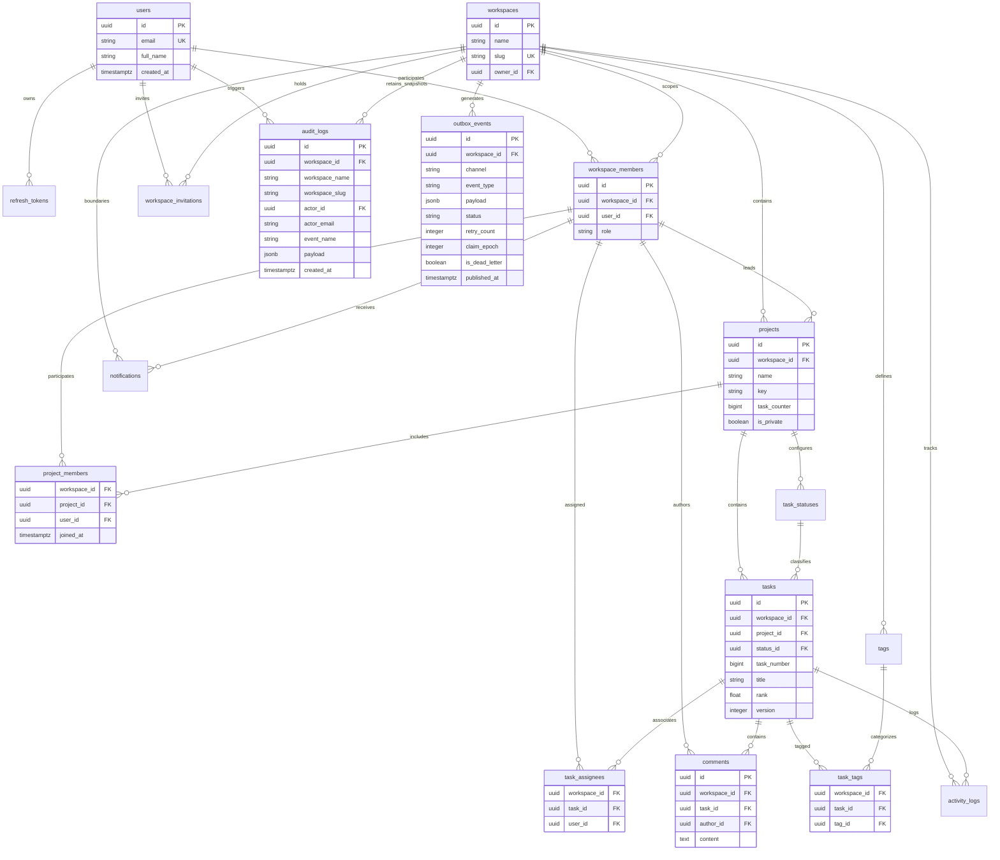

# NEXUS: TECHNICAL BLUEPRINT & SYSTEM ARCHITECTURE SPECIFICATION
**Document Version:** 1.3.1 (Targeted Correction Patch)  
**Phase:** Phase 0 — Product Requirements & System Architecture  
**Architects:** Principal Software Architect, Senior Backend Engineer, PostgreSQL Database Architect, Application Security Engineer & Distributed Systems Engineer  
**Target Platform:** Production-Ready Multi-Tenant SaaS Workspace  
**Status:** APPROVED FOR PHASE 1 IMPLEMENTATION  

---

## 1. EXECUTIVE SUMMARY AND ARCHITECTURE DECISIONS

### 1.1 Executive Summary
**Nexus** is a production-grade, multi-tenant, real-time team collaboration and project management SaaS platform. Drawing functional and aesthetic inspiration from **Linear** (keyboard-first speed, density, and refined micro-interactions), **Notion** (flexible workspace hierarchy and structured documents), and **ClickUp** (robust task workflows and workload tracking), Nexus delivers a cohesive, dark-first collaborative workspace designed for modern product engineering teams and solo founders.

This document—Version 1.3.1—implements targeted corrections to the architecture specification. It explicitly defines the boundaries between relational-engine and hybrid application multi-tenant isolation, enforces the workspace ownership invariant at the database level via a partial unique index, introduces distributed fencing tokens (`claim_epoch`) to the transactional outbox, formalizes token grace-chain traversal under Redis outages, specifies immediate access-token invalidation via Redis revocation epochs, eliminates Kanban cross-column locking deadlocks via deterministic `id ASC` mutex ordering, consolidates rebalance events into single atomic payloads, and formalizes deployment database roles.

### 1.2 Core Architectural Invariants (v1.3.1)

```
+-----------------------------------------------------------------------------------------------------------------------+
|                                      NEXUS PLATFORM ARCHITECTURAL INVARIANTS                                          |
+-----------------------------+--------------------------------------------------+--------------------------------------+
| Subsystem                   | Architectural Decision                           | Formal Invariant Guarantee           |
+-----------------------------+--------------------------------------------------+--------------------------------------+
| Multi-Tenant Isolation      | Relational Engine Containment (Composite FKs)    | Zero cross-tenant relational links   |
|                             | + Hybrid Scoping for Polymorphic References      | for hierarchical data; strict tenant |
|                             | (PostgreSQL 16 Engine-level containment)         | boundary scoping on polymorphic rows.|
+-----------------------------+--------------------------------------------------+--------------------------------------+
| Workspace Ownership         | Single-Owner Partial Unique Index + 8-Step Swap  | Database engine guarantees <= 1 owner|
|                             | (uq_workspace_single_owner + row locks)          | atomic transaction guarantees >= 1.  |
+-----------------------------+--------------------------------------------------+--------------------------------------+
| Session Security            | Dual-Store Rotation (PG Commit-First + Redis)    | Grace-chain traversal guarantees no  |
|                             | with Authenticated AES-256-GCM Grace Stash       | split-brain tokens; 15s replay bound.|
+-----------------------------+--------------------------------------------------+--------------------------------------+
| Token Revocation            | Short-Lived JWT (15m) + Redis Revocation Epoch   | Immediate sub-second access-token    |
|                             | (user_revocation_epoch:<user_id>)                | invalidation on logout/credential chg|
+-----------------------------+--------------------------------------------------+--------------------------------------+
| Event Reliability           | Transactional Outbox with SKIP LOCKED Claiming   | Fencing tokens (claim_epoch) prevent |
|                             | and Distributed Fencing Tokens                   | zombie worker double-publishing.     |
+-----------------------------+--------------------------------------------------+--------------------------------------+
| Real-Time Permissions       | Redis Control Bus Eviction + 60s Revalidation    | Sub-second WebSocket eviction on     |
|                             | (`nexus:control:auth_invalidation`)              | membership/project access revocation.|
+-----------------------------+--------------------------------------------------+--------------------------------------+
| Kanban Concurrency          | Deterministic Status Locks (ORDER BY id ASC)     | Zero AB-BA deadlocks; serialized     |
|                             | + Bulk 'column.rebalanced' Event Payload         | moves; zero event storms on rebalance|
+-----------------------------+--------------------------------------------------+--------------------------------------+
| Audit Log Immutability      | Append-Only Schema + ON DELETE SET NULL +        | Compliance records survive tenant    |
|                             | Deployment Role Separation (Migrator/App/Maint)  | deletion with full snapshot context. |
+-----------------------------+--------------------------------------------------+--------------------------------------+
```

---

## 2. PRODUCT REQUIREMENTS AND SYSTEM SCOPE

### 2.1 Product Vision & Guiding Tenets
Nexus is engineered around **"Zero-Friction Flow"**:
1. **Perceived Latency < 100ms**: The web interface executes optimistic UI state transitions immediately, reconciling asynchronously with server state.
2. **Mathematically Honest Multi-Tenancy**: Data isolation is physically enforced by relational engine constraints where composite relationships exist, and rigorously validated via tenant-bound query parameters for polymorphic references.
3. **No Phantom State**: Real-time board movements, task state edits, and notifications propagate reliably across distributed nodes, while client reconnects automatically restore state from authoritative REST snapshots.
4. **Ergonomic Keyboard Navigation**: Core navigation, task triage, status changes, and quick switching operate seamlessly via command palette (`Cmd+K`) and keyboard shortcuts.

### 2.2 System Scope & Feature Matrix

| Functional Area | In Scope (MVP Core) | Explicitly Deferred (Post-MVP) |
| :--- | :--- | :--- |
| **Authentication** | Email/password, Argon2id hashing, JWT access tokens, HTTP-only refresh cookies, session management, Redis revocation epochs. | OAuth2/SSO (Google, GitHub, SAML), WebAuthn/Passkeys, TOTP 2FA. |
| **Tenancy & Roles** | Multi-tenant workspaces, vanity slugs, owner/admin/member roles, cryptographic invitations with status lifecycle. | Custom dynamic enterprise roles, cross-workspace guest accounts. |
| **Project Tracking** | Projects, public/private access scoping, custom Kanban columns, fractional indexing drag-and-drop. | Gantt charts, swimlanes, dependency graphs, sprint planning poker. |
| **Task Management** | Markdown descriptions, task assignees, tags, priority levels, due dates, collision-free 64-bit numbers. | Custom task fields, recurring tasks, automated task formulas. |
| **Collaboration** | Markdown comments, `@username` mentions, in-app notification center, unread counters. | Real-time collaborative rich-text canvas (Notion-style CRDT block editing). |
| **Real-Time** | WebSocket state broadcast, ticket handshake, active subscription revocation, user presence. | Audio huddles, peer-to-peer screen sharing, end-to-end encrypted chats. |
| **Analytics** | Velocity tracking, status distributions, team workload distribution, burndown charts. | Custom BI report builder, external data pipeline webhooks, machine learning forecasting. |
| **Audit & Security** | Immutable security audit logs, rate-limiting, proxy ticket log redaction, 365-day retention, role separation. | Automated SOC2 continuous evidence streaming, external SIEM syslog forwards. |

---

## 3. SYSTEM ARCHITECTURE AND COMPONENT RESPONSIBILITIES

Nexus is designed as a **Modular Monolith** optimized for solo-developer operational maintainability, exceptional developer velocity, and robust horizontal scalability:

```
                                  +-----------------------+
                                  |   Web Browser Client  |
                                  | React 18 / TypeScript |
                                  +-----------+-----------+
                                              |
                   HTTPS (REST API)           |          WSS (WebSockets)
                   Cookie: __Host-nexus_rt    |          Query: ?ticket=<uuid>
                                              v
                                  +-----------------------+
                                  |      Nginx Proxy      |
                                  | SSL, Rate-Limit, Log  |
                                  | Ticket Regex Masking  |
                                  +-----------+-----------+
                                              |
                       +----------------------+----------------------+
                       | Proxy Pass                                  | WebSocket Upgrade
                       v                                             v
        +-----------------------------+               +-----------------------------+
        |   FastAPI REST API Server   |               |   FastAPI WebSocket Node    |
        | Stateless Application Pod   |               | Persistent Connection Node  |
        +--------------+--------------+               +--------------+--------------+
                       |                                             |
         SQL Queries / |                                             | Redis Sub /
         ACID Outbox   |                                             | Ticket GETDEL
                       v                                             v
        +-----------------------------+               +-----------------------------+
        |        PostgreSQL 16        |◄──────────────┤           Redis 7           |
        | - Tenant Composite Schema   |  Outbox Worker| - Pub/Sub Event Bus         |
        | - Fenced SKIP LOCKED Polling|  LISTEN/NOTIFY| - AES Grace Stash (15s)     |
        | - Immutable Audit Tables    |               | - WS Single-Use Tickets     |
        | - Migrator/App/Maint Roles  |               | - Revocation Epochs (15m)   |
        +-----------------------------+               +-----------------------------+
```

### Component Responsibilities:
1. **Nginx Reverse Proxy**:
   - Terminates TLS/SSL using modern cipher suites.
   - Enforces security response headers (HSTS, CSP, X-Frame-Options, X-Content-Type-Options).
   - Sanitizes and redacts single-use WebSocket tickets in access logs via `combined_redacted`.
   - Routes `/api/v1/` to FastAPI REST workers and `/ws` to FastAPI WebSocket gateway workers.
2. **FastAPI Application Server (REST Pods)**:
   - Enforces `WorkspaceContext` tenant boundary injection on every authenticated route.
   - Validates user revocation epochs against Redis (`user_revocation_epoch:<user_id>`) for instant access-token revocation.
   - Executes atomic business mutations and inserts corresponding events into `outbox_events` within the same ACID database transaction.
   - Issues short-lived JWT access tokens (15m) and environment-aware HTTP-only refresh cookies (7d).
   - Publishes administrative revocation signals to Redis control channel `nexus:control:auth_invalidation`.
3. **FastAPI WebSocket Nodes (Gateway Pods)**:
   - Validates connection tickets via atomic Redis `GETDEL` (single-use, 60-second TTL).
   - Manages client channel subscriptions (`project:<id>`, `task:<id>`, `user:<id>`) with explicit authorization.
   - Subscribes to Redis channels and relays events to connected browser sessions.
   - Subscribes to `nexus:control:auth_invalidation` and immediately disconnects revoked users or drops invalid subscriptions.
   - Runs a 60-second periodic audit re-checking connected user memberships as a fail-safe against dropped control frames.
4. **Outbox Worker Daemon (Celery / Asyncio Worker)**:
   - Claims batches of pending outbox events using PostgreSQL `FOR UPDATE SKIP LOCKED`.
   - Increments distributed fencing token `claim_epoch` on claim to prevent zombie worker double-publishing.
   - Publishes payloads to Redis Pub/Sub with exponential backoff and jitter ($2^{\text{retry\_count}} \times 1\text{s} \pm 10\%$).
   - Reclaims abandoned processing events exceeding the 60-second lease timeout.
   - Routes permanently failing events (5th failure) to `is_dead_letter = TRUE` and triggers Prometheus alerts.
5. **PostgreSQL 16 Relational Engine**:
   - The authoritative system of record for all persistent application state.
   - Physical enforcement of multi-tenant referential integrity via composite foreign keys and column-specific `ON DELETE SET NULL (column)`.
   - Physical enforcement of the single-owner invariant via partial unique index `uq_workspace_single_owner`.
   - Strict privilege separation across three operational roles: `nexus_migrator` (DDL), `nexus_app` (Runtime DML), and `nexus_maintenance` (Purging).
6. **Redis 7 In-Memory Datastore**:
   - Ephemeral message broker for real-time Pub/Sub broadcasts and control events.
   - Ephemeral encrypted grace stash (`rt_grace:<sha256(R1)>`) for concurrent refresh recovery (15s TTL).
   - Ephemeral ticket store for WebSocket authentication handshakes (60s TTL).
   - Revocation epoch store for immediate access token invalidation (`user_revocation_epoch:<user_id>`, 15m TTL).
   - Distributed rate-limiting counters via Redis sliding-window scripts.

---

## 4. FUNCTIONAL MODULES AND DOMAIN BOUNDARIES

The system domain model is strictly partitioned into 13 cohesive functional modules:

```
+---------------------------------------------------------------------------------------------------------+
|                                          NEXUS PLATFORM CORE                                            |
+---------------------------------------------------------------------------------------------------------+
| [01. Auth & Users]      [02. Workspaces]         [03. Members & Invites]   [04. Projects]               |
| [05. Task Engine]       [06. Kanban System]      [07. Comments & Collab]   [08. Real-time Notifications]|
| [09. Activity Feeds]    [10. Analytics/Reports]  [11. User Settings]       [12. RBAC & Permissions]     |
| [13. Audit Logging]                                                                                     |
+---------------------------------------------------------------------------------------------------------+
```

### Module Specifications:
- **01. Authentication & Users**: User identity, credential verification (Argon2id), session lifecycle, refresh token rotation, cross-tab refresh coordination, Redis revocation epochs, and global session revocation.
- **02. Workspace Management**: Multi-tenant workspace containers, URL vanity slugs, workspace metadata, and dedicated atomic ownership transfer.
- **03. Members & Invitations**: Member onboarding, cryptographic invite tokens with full status lifecycle (`pending`, `accepted`, `revoked`, `expired`), role assignments (`owner`, `admin`, `member`), and member removal with cascading socket eviction.
- **04. Projects**: Project management, project keys (`KEY-`), visibility scoping (`is_private`), project leads, project membership lists, and atomic 64-bit project task counters.
- **05. Task Engine**: Task CRUD, markdown descriptions, priority queues (`urgent`, `high`, `medium`, `low`), due dates, assignees, tags, and optimistic concurrency versioning (`version`).
- **06. Kanban System**: Dynamic project workflow columns, drag-and-drop reordering with fractional indexing ranks, deterministic two-column mutex serialization (`ORDER BY id ASC`), bulk `column.rebalanced` event emission, and deterministic rebalancing.
- **07. Comments & Collaboration**: Markdown task discussions, `@username` mention detection and automatic notification queuing, and comment history.
- **08. Real-Time Notifications**: User notification queue, polymorphic entity references with hybrid tenant validation, unread counters, real-time push over WebSockets, and bulk read state toggles.
- **09. Activity Feeds**: Human-readable audit trails of project and task lifecycle events, surviving entity deletion with snapshot attribution.
- **10. Analytics & Reporting**: Real-time project velocity metrics, Kanban column distribution counts, burndown rates, and team workload balance analysis.
- **11. User Settings**: User profiles, avatar URLs, notification preference matrices, and active device session termination.
- **12. RBAC & Permissions**: Multi-tier access control validation, private project boundary enforcement, and real-time subscription revocation.
- **13. Audit Logging**: Immutable, append-only compliance logs recording security events, privilege escalations, and ownership transfers, backed by privileged retention separation.

---

## 5. MULTI-TENANCY AND AUTHORIZATION MODEL

### 5.1 Honest Isolation Boundary: Relational Engine Containment vs. Hybrid Application Scoping
Nexus establishes a mathematically rigorous distinction between two classes of data isolation:

```
+-------------------------------------------------------------------------------------------------------+
|                                    NEXUS DATA ISOLATION TAXONOMY                                      |
+------------------------+----------------------------------------------------+-------------------------+
| Category               | Applicable Entities                                | Enforcement Mechanism   |
+------------------------+----------------------------------------------------+-------------------------+
| 1. Hierarchical Strict | projects, task_statuses, tasks, task_assignees,    | PostgreSQL 16 Composite |
|    Engine Containment  | task_tags, project_members, comments               | Foreign Keys (Engine)   |
+------------------------+----------------------------------------------------+-------------------------+
| 2. Hybrid Polymorphic  | notifications (entity_type, entity_id),            | Application Validation  |
|    Tenant Scoping      | activity_logs (verb, changes JSONB)                | + Scoped SQL Queries    |
+------------------------+----------------------------------------------------+-------------------------+
| 3. Global Identity     | users (email, hashed_password, profile)            | Global Table; Scoped via|
|    Boundary            |                                                    | workspace_members links |
+------------------------+----------------------------------------------------+-------------------------+
```

1. **Hierarchical Strict Engine Containment**:
   For all core relational entities, parent-child links require matching `workspace_id`. Cross-tenant links are physically rejected by the PostgreSQL engine.
2. **Hybrid Polymorphic Tenant Scoping**:
   In `notifications`, `entity_id` is a polymorphic UUID pointing to different tables (`tasks`, `projects`, `comments`). Relational database engines cannot enforce a single foreign key across heterogeneous target tables. Therefore:
   - Tenant isolation is guaranteed by **Application Transaction Validation**: Every notification generation routine resolves the target entity within the current `WorkspaceContext` before insertion.
   - Notification retrieval endpoints enforce: `SELECT * FROM notifications WHERE workspace_id = :workspace_id AND recipient_id = :user_id`.
   - Notification resolution queries for target entities explicitly bind: `SELECT * FROM tasks WHERE workspace_id = :workspace_id AND id = :entity_id`. Even if an invalid `entity_id` was written, it can never resolve across tenant boundaries.

### 5.2 PostgreSQL 16 Engine-Level Composite Foreign Keys
Nexus mandates **PostgreSQL 16** for its native support of standard SQL:2008 column-list syntax: `ON DELETE SET NULL (column_list)`.

```
                                  +-------------------+
                                  |    workspaces     |
                                  +---------+---------+
                                            |
                     +----------------------+----------------------+
                     | (workspace_id, id)                          | (workspace_id, user_id)
                     v                                             v
           +-------------------+                         +-------------------+
           |     projects      |                         | workspace_members |
           +---------+---------+                         +---------+---------+
                     |                                             |
                     | (workspace_id, project_id)                  |
                     +----------------------+                      |
                     |                      |                      |
                     v                      v                      |
           +-------------------+  +-------------------+            |
           |   task_statuses   |  |       tasks       |            |
           +-------------------+  +---------+---------+            |
                                            |                      |
                       +---------------------+----------------------+
                       | (workspace_id, task_id)                    | (workspace_id, user_id)
                       v                                            v
           +-----------------------------------------------------------------+
           |                       task_assignees                            |
           |  Enforces: Assignee MUST belong to the task's exact workspace   |
           +-----------------------------------------------------------------+
```

#### Referential Enforcement Rules:
1. **`projects.lead_id`**:
   `FOREIGN KEY (workspace_id, lead_id) REFERENCES workspace_members(workspace_id, user_id) ON DELETE SET NULL (lead_id)`
2. **`project_members`**:
   `FOREIGN KEY (workspace_id, project_id) REFERENCES projects(workspace_id, id) ON DELETE CASCADE`
   `FOREIGN KEY (workspace_id, user_id) REFERENCES workspace_members(workspace_id, user_id) ON DELETE CASCADE`
3. **`task_assignees`**:
   `FOREIGN KEY (workspace_id, task_id) REFERENCES tasks(workspace_id, id) ON DELETE CASCADE`
   `FOREIGN KEY (workspace_id, user_id) REFERENCES workspace_members(workspace_id, user_id) ON DELETE CASCADE`
4. **`task_tags`**:
   `FOREIGN KEY (workspace_id, task_id) REFERENCES tasks(workspace_id, id) ON DELETE CASCADE`
   `FOREIGN KEY (workspace_id, tag_id) REFERENCES tags(workspace_id, id) ON DELETE CASCADE`
5. **`comments.author_id`**:
   `FOREIGN KEY (workspace_id, task_id) REFERENCES tasks(workspace_id, id) ON DELETE CASCADE`
   `FOREIGN KEY (workspace_id, author_id) REFERENCES workspace_members(workspace_id, user_id) ON DELETE SET NULL (author_id)`
6. **`notifications.recipient_id`**:
   `FOREIGN KEY (workspace_id, recipient_id) REFERENCES workspace_members(workspace_id, user_id) ON DELETE CASCADE`

---

### 5.3 Workspace Ownership Invariants: Database Engine & Transactional Dual-Guarantees

#### Core Invariant
**At all times, exactly one member in a workspace possesses `role = 'owner'`, and this user must match `workspaces.owner_id`.**

In v1.3.1, this invariant is fortified with both database-engine and transaction-level guarantees:

1. **Database Engine Guarantee: Partial Unique Index**:
   ```sql
   CREATE UNIQUE INDEX uq_workspace_single_owner 
   ON workspace_members (workspace_id) 
   WHERE role = 'owner';
   ```
   **Engine Guarantee**: PostgreSQL physically prevents more than one record with `role = 'owner'` from ever existing for the same `workspace_id`. Any concurrent attempt to create or promote a second owner is aborted by the database engine with a unique violation error (`uq_workspace_single_owner`).

2. **Transactional Guarantee: Exactly One Owner**:
   To prevent zero-owner states, role changes and ownership transfers are strictly gated:
   - **Workspace Creation**: Inserts `workspaces` and `workspace_members` with `role = 'owner'` in a single transaction.
   - **Generic Role Updates (`PATCH /members/{user_id}`)**:
     Explicitly rejects assigning `role = 'owner'` (`400 Bad Request: CANNOT_ASSIGN_OWNER_VIA_ROLE_UPDATE`).
     Explicitly rejects demoting or modifying the active owner (`400 Bad Request: CANNOT_MODIFY_OWNER_ROLE`).
   - **Member Removal (`DELETE /members/{user_id}`)**:
     Locks membership row `FOR UPDATE`. If `role == 'owner'`, aborts with `400 Bad Request: CANNOT_REMOVE_WORKSPACE_OWNER`.
   - **Dedicated Ownership Transfer (`POST /transfer-ownership`)**:
     The sole operation authorized to assign `'owner'`. In the atomic 8-step SQL transaction, the current owner is demoted to `'admin'` **first**, and the new owner is promoted to `'owner'` **second**, satisfying `uq_workspace_single_owner` without constraint violation.

---

## 6. AUTHENTICATION AND SESSION SECURITY

### 6.1 Cookie Specification & Environment Configuration

| Directive | Production (`ENVIRONMENT=production`) | Development (`ENVIRONMENT=development`) | Security Rationale |
| :--- | :--- | :--- | :--- |
| **Cookie Name** | `__Host-nexus_rt` | `nexus_rt_dev` | RFC 6265bis forbids `__Host-` cookies on insecure HTTP (`localhost`). |
| **Secure Flag** | `True` | `False` | Plain HTTP on `localhost:5173` cannot set Secure cookies without local TLS. |
| **Path Attribute** | `/` | `/` | Mandated by RFC 6265bis for `__Host-` prefix (must be root `/`). |
| **HttpOnly Flag** | `True` | `True` | Blocks JavaScript access, preventing cross-site scripting (XSS) exfiltration. |
| **SameSite Policy** | `Lax` (with Anti-CSRF Header) | `Lax` | Protects against cross-site POST while allowing deep-linking from email. |
| **Domain Attribute** | Omitted | Omitted | Mandated by RFC 6265bis (must be host-only; subdomains cannot access). |

### 6.2 CSRF Protection Architecture
1. **Strict Origin & Referer Whitelisting**: Every mutating request (`POST`, `PUT`, `PATCH`, `DELETE`) inspects `Origin` / `Referer`. Discrepancies abort with `403 Forbidden: INVALID_ORIGIN`.
2. **Mandatory Custom Header**: Sensitive cookie endpoints (`POST /refresh`, `POST /logout`) mandate header `X-Requested-With: XMLHttpRequest` or `X-Nexus-Client: web`. Standard browser cross-origin forms cannot set custom headers without triggering CORS preflights.

### 6.3 Browser Cross-Tab Coordination: Web Locks & Bounded Fallback
- **Primary Coordinator**: **Web Locks API (`navigator.locks.request`)**, providing browser-kernel guaranteed mutual exclusion.
- **Fallback Coordinator**: Best-effort heuristic using `BroadcastChannel('nexus_auth_bus')` paired with a lease in `localStorage` and a bounded safety timer (`WAIT_TIMEOUT_MS = 6000ms`). Waiting tabs never hang indefinitely if a leader tab closes or crashes.
- **Authoritative Server Safety**: Server-side dual-store rotation protocol is authoritative and concurrency-safe under all conditions.

---

### 6.4 Refresh-Token Concurrent Recovery & Grace-Chain Traversal

#### Problem Definition
When Tab 1 rotates $R_1 \to R_2$, PostgreSQL commits and writes $R_2$ to Redis grace stash. If Redis is unavailable or the grace key is missing, PostgreSQL stores only `token_hash = SHA256(R2)`, making raw $R_2$ reconstruction impossible. If Tab 2 presents $R_1$ concurrently, how does the server recover safely without creating split-brain active tokens or triggering false-positive replay revocations?

#### Solution: Token Grace-Chain Traversal & Atomic Sub-Rotation
Every rotated token record maintains `rotated_at` and `replaced_by`. When a rotated token is presented:

```
[Incoming POST /api/v1/auth/refresh with Cookie Token R_in]
                             │
                             ▼
         [PostgreSQL: SELECT ... FOR UPDATE on R_in]
                             │
            ┌────────────────┴────────────────┐
            │                                 │
     [R_in Unrotated]                  [R_in Revoked]
     (is_revoked == FALSE)            (is_revoked == TRUE)
            │                                 │
            ▼                                 ▼
   [Branch A: Happy Path]          [Check rotated_at timestamp]
   - Insert R_new                             │
   - Mark R_in.replaced_by = R_new.id  ┌──────┴──────┐
   - Mark R_in.is_revoked = TRUE       │             │
   - COMMIT POSTGRESQL          [< 15s Grace]  [>= 15s Replay]
            │                          │             │
            ▼                          ▼             ▼
   [Post-Commit Redis Stash]   [Traverse Chain] [Branch C: Replay]
   - Encrypt R_new AES-256-GCM  Follow pointer   - Revoke entire family
   - SETEX rt_grace 15s         to leaf R_active - Clear cookie (Max-Age=0)
   - Return R_new Cookie & JWT         │         - 403 Forbidden
                                       │
                      ┌────────────────┴────────────────┐
                      │                                 │
               [Redis Stash Hit]               [Redis Miss / Outage]
               - Decrypt R_active              - Lock R_active FOR UPDATE
               - Return R_active Cookie        - Atomic Sub-Rotation:
                 & fresh Access Token            Generate R_next;
               - NO new rotation.                R_active.replaced_by = R_next.id;
                                                 Commit PG;
                                                 Return R_next Cookie & JWT.
```

#### Detailed Execution Rules:
1. **Grace-Chain Traversal**:
   When $R_1$ is presented with `is_revoked == TRUE` and `NOW() - rotated_at < 15s`:
   - Follow `replaced_by` pointer to find the current active leaf token $R_{\text{active}}$.
   - Verify that all intermediary tokens in the chain have `NOW() - rotated_at < 15s`.
2. **Redis Hit Branch**:
   - Decrypt cached envelope for $R_{\text{active}}$ from Redis using `TOKEN_ENCRYPTION_KEY` and verify AAD `family_id:user_id`.
   - Verify $R_{\text{active}}$ in PostgreSQL has `is_revoked == FALSE`.
   - Return existing $R_{\text{active}}$ in cookie + fresh JWT access token. No new database rotation occurs.
3. **Redis Miss / Outage Branch (Atomic Sub-Rotation)**:
   - Server locks $R_{\text{active}}$ `FOR UPDATE`.
   - If $R_{\text{active}}$ is unrevoked, server executes an **atomic sub-rotation**: generates $R_{\text{next}}$, marks $R_{\text{active}}$: `is_revoked=TRUE, rotated_at=NOW(), replaced_by=R_next.id`, and updates the parent pointer.
   - Commits PostgreSQL. Returns fresh $R_{\text{next}}$ in cookie + fresh JWT access token.
   - **Invariant Guarantee**: Exactly ONE active leaf token ($R_{\text{next}}$) exists in the database. Sibling tabs presenting $R_1$, $R_2$, or $R_{\text{active}}$ within 15 seconds follow the chain to $R_{\text{next}}$ and receive valid tokens without false-positive family revocation.
4. **Explicit Logout During Grace Period**:
   - If $R_{\text{active}}$ has `is_revoked == TRUE` and `replaced_by IS NULL` (explicit logout) or the family was terminated:
   - Aborts with `401 Unauthorized` (`SESSION_TERMINATED`), sends `Set-Cookie: __Host-nexus_rt = ""; Max-Age=0`.

---

### 6.5 Immediate Access-Token & WebSocket Revocation Architecture

#### 1. Access-Token Revocation via Redis Revocation Epochs
Because JWT access tokens are stateless with a 15-minute lifetime, standard signature validation alone cannot revoke a token prior to its expiration. Nexus implements an **In-Memory Revocation Epoch**:
- **Epoch Storage**: When a user logs out, changes password, or has sessions terminated, the API sets:
  ```
  SET user_revocation_epoch:<user_id> <current_unix_timestamp> EX 900
  ```
  (TTL is set to 900 seconds / 15 minutes, matching maximum access token lifespan).
- **FastAPI Auth Verification**:
  ```python
  # In get_current_user dependency:
  payload = jwt.decode(token, settings.JWT_SECRET, algorithms=["HS256"])
  user_id = payload["sub"]
  token_iat = payload["iat"]

  # Lightweight sub-millisecond Redis check
  revocation_epoch = await redis.get(f"user_revocation_epoch:{user_id}")
  if revocation_epoch and token_iat < int(revocation_epoch):
      raise HTTPException(status_code=401, detail="TOKEN_REVOKED")
  ```
- **Outcome**: Immediate, sub-second global access-token invalidation across all distributed REST pods without querying PostgreSQL on every request.

#### 2. WebSocket Subscription Eviction & Periodic Audit Revalidation
- **Real-Time Control Bus**: Upon any membership change, role demotion, or project access revocation, the API publishes to Redis channel `nexus:control:auth_invalidation`:
  ```json
  {
    "action": "EVICT_WORKSPACE_MEMBER" | "REVOKE_PROJECT_SUBSCRIPTION",
    "workspace_id": "<uuid>",
    "user_id": "<uuid>",
    "project_id": "<uuid>",
    "timestamp": 1740000000
  }
  ```
- **Gateway Node Eviction**:
  - `EVICT_WORKSPACE_MEMBER`: Finds active socket connections for `user_id` and terminates connection immediately with close code **`4403`** (`MEMBER_REMOVED_FROM_WORKSPACE`).
  - `REVOKE_PROJECT_SUBSCRIPTION`: Detaches socket from `project:<id>` and associated tasks, pushing `{ "type": "subscription_revoked", "channel": "project:<id>", "reason": "MEMBERSHIP_REVOKED" }`.
- **Periodic Audit Revalidation (Fail-Safe)**:
  To guarantee revocation even if a WebSocket node temporarily drops its Redis Pub/Sub subscription, every active connection executes a lightweight membership verification check every 60 seconds during ping/pong heartbeats against Redis `user_workspaces:<user_id>`. If the membership has lapsed, the socket is evicted immediately.

---

## 7. DATABASE SCHEMA AND INTEGRITY CONSTRAINTS (v1.3.1)

### Table: `users`
- `id`: UUID PRIMARY KEY DEFAULT gen_random_uuid()
- `email`: VARCHAR(255) NOT NULL
- `hashed_password`: VARCHAR(255) NOT NULL
- `full_name`: VARCHAR(100) NOT NULL
- `avatar_url`: VARCHAR(512) NULL
- `bio`: TEXT NULL
- `is_active`: BOOLEAN DEFAULT TRUE NOT NULL
- `created_at`: TIMESTAMPTZ DEFAULT NOW() NOT NULL
- `updated_at`: TIMESTAMPTZ DEFAULT NOW() NOT NULL
- *Constraints & Indexes*:
  - `CREATE UNIQUE INDEX uq_users_email_lower ON users (LOWER(email));`

### Table: `refresh_tokens`
- `id`: UUID PRIMARY KEY DEFAULT gen_random_uuid()
- `user_id`: UUID NOT NULL REFERENCES users(id) ON DELETE CASCADE
- `token_hash`: VARCHAR(255) UNIQUE NOT NULL
- `family_id`: UUID NOT NULL
- `is_revoked`: BOOLEAN DEFAULT FALSE NOT NULL
- `rotated_at`: TIMESTAMPTZ NULL
- `replaced_by`: UUID NULL REFERENCES refresh_tokens(id) ON DELETE SET NULL
- `expires_at`: TIMESTAMPTZ NOT NULL
- `created_at`: TIMESTAMPTZ DEFAULT NOW() NOT NULL
- *Indexes*:
  - `CREATE INDEX idx_refresh_tokens_family ON refresh_tokens (family_id);`
  - `CREATE INDEX idx_refresh_tokens_user ON refresh_tokens (user_id);`

### Table: `workspaces`
- `id`: UUID PRIMARY KEY DEFAULT gen_random_uuid()
- `name`: VARCHAR(100) NOT NULL
- `slug`: VARCHAR(120) NOT NULL
- `logo_url`: VARCHAR(512) NULL
- `owner_id`: UUID NOT NULL REFERENCES users(id) ON DELETE RESTRICT
- `created_at`: TIMESTAMPTZ DEFAULT NOW() NOT NULL
- `updated_at`: TIMESTAMPTZ DEFAULT NOW() NOT NULL
- *Constraints & Indexes*:
  - `UNIQUE(id)`
  - `CREATE UNIQUE INDEX uq_workspaces_slug_lower ON workspaces (LOWER(slug));`
  - `CHECK (slug ~ '^[a-z0-9]+(-[a-z0-9]+)*$')`

### Table: `workspace_members`
- `id`: UUID PRIMARY KEY DEFAULT gen_random_uuid()
- `workspace_id`: UUID NOT NULL REFERENCES workspaces(id) ON DELETE CASCADE
- `user_id`: UUID NOT NULL REFERENCES users(id) ON DELETE CASCADE
- `role`: VARCHAR(20) NOT NULL CHECK (role IN ('owner', 'admin', 'member'))
- `joined_at`: TIMESTAMPTZ DEFAULT NOW() NOT NULL
- *Constraints & Indexes*:
  - `UNIQUE(workspace_id, user_id)` (Composite key for tenancy)
  - `CREATE UNIQUE INDEX uq_workspace_single_owner ON workspace_members (workspace_id) WHERE role = 'owner';`
  - `CREATE INDEX idx_workspace_members_user ON workspace_members (user_id);`

### Table: `workspace_invitations`
- `id`: UUID PRIMARY KEY DEFAULT gen_random_uuid()
- `workspace_id`: UUID NOT NULL REFERENCES workspaces(id) ON DELETE CASCADE
- `email`: VARCHAR(255) NOT NULL
- `role`: VARCHAR(20) DEFAULT 'member' NOT NULL CHECK (role IN ('admin', 'member'))
- `token_hash`: VARCHAR(255) UNIQUE NOT NULL
- `status`: VARCHAR(20) DEFAULT 'pending' NOT NULL CHECK (status IN ('pending', 'accepted', 'revoked', 'expired'))
- `invited_by`: UUID NULL REFERENCES users(id) ON DELETE SET NULL
- `expires_at`: TIMESTAMPTZ NOT NULL
- `accepted_at`: TIMESTAMPTZ NULL
- `created_at`: TIMESTAMPTZ DEFAULT NOW() NOT NULL
- *Constraints & Indexes*:
  - `CREATE UNIQUE INDEX uq_invites_active ON workspace_invitations (workspace_id, LOWER(email)) WHERE status = 'pending';`

### Table: `projects`
- `id`: UUID PRIMARY KEY DEFAULT gen_random_uuid()
- `workspace_id`: UUID NOT NULL REFERENCES workspaces(id) ON DELETE CASCADE
- `name`: VARCHAR(100) NOT NULL
- `key`: VARCHAR(10) NOT NULL CHECK (key ~ '^[A-Z0-9]{2,10}$')
- `description`: TEXT NULL
- `lead_id`: UUID NULL
- `task_counter`: BIGINT DEFAULT 0 NOT NULL CHECK (task_counter >= 0 AND task_counter < 9223372036854775800)
- `is_private`: BOOLEAN DEFAULT FALSE NOT NULL
- `status`: VARCHAR(20) DEFAULT 'active' NOT NULL CHECK (status IN ('active', 'archived', 'completed'))
- `deleted_at`: TIMESTAMPTZ NULL
- `created_at`: TIMESTAMPTZ DEFAULT NOW() NOT NULL
- `updated_at`: TIMESTAMPTZ DEFAULT NOW() NOT NULL
- *Constraints & Composite Foreign Keys*:
  - `UNIQUE(workspace_id, id)`
  - `CREATE UNIQUE INDEX uq_projects_key ON projects (workspace_id, key) WHERE deleted_at IS NULL;`
  - `FOREIGN KEY (workspace_id, lead_id) REFERENCES workspace_members(workspace_id, user_id) ON DELETE SET NULL (lead_id)`

### Table: `project_members`
- `workspace_id`: UUID NOT NULL
- `project_id`: UUID NOT NULL
- `user_id`: UUID NOT NULL
- `joined_at`: TIMESTAMPTZ DEFAULT NOW() NOT NULL
- *Constraints & Composite Foreign Keys*:
  - `PRIMARY KEY (project_id, user_id)`
  - `FOREIGN KEY (workspace_id, project_id) REFERENCES projects(workspace_id, id) ON DELETE CASCADE`
  - `FOREIGN KEY (workspace_id, user_id) REFERENCES workspace_members(workspace_id, user_id) ON DELETE CASCADE`

### Table: `task_statuses` (Kanban Columns)
- `id`: UUID PRIMARY KEY DEFAULT gen_random_uuid()
- `workspace_id`: UUID NOT NULL
- `project_id`: UUID NOT NULL
- `name`: VARCHAR(50) NOT NULL
- `rank`: DOUBLE PRECISION NOT NULL
- `color_hex`: VARCHAR(7) DEFAULT '#6366F1' NOT NULL CHECK (color_hex ~ '^#[0-9A-Fa-f]{6}$')
- `is_completed_state`: BOOLEAN DEFAULT FALSE NOT NULL
- `deleted_at`: TIMESTAMPTZ NULL
- *Constraints & Composite Foreign Keys*:
  - `UNIQUE(project_id, id)`
  - `FOREIGN KEY (workspace_id, project_id) REFERENCES projects(workspace_id, id) ON DELETE CASCADE`
  - `CREATE UNIQUE INDEX uq_statuses_name ON task_statuses (project_id, name) WHERE deleted_at IS NULL;`
  - `CREATE INDEX idx_statuses_rank ON task_statuses (project_id, rank ASC);`

### Table: `tasks`
- `id`: UUID PRIMARY KEY DEFAULT gen_random_uuid()
- `workspace_id`: UUID NOT NULL
- `project_id`: UUID NOT NULL
- `status_id`: UUID NOT NULL
- `task_number`: BIGINT NOT NULL CHECK (task_number > 0)
- `title`: VARCHAR(255) NOT NULL
- `description`: TEXT NULL
- `priority`: VARCHAR(20) DEFAULT 'medium' NOT NULL CHECK (priority IN ('urgent', 'high', 'medium', 'low'))
- `rank`: DOUBLE PRECISION NOT NULL
- `version`: INTEGER DEFAULT 1 NOT NULL
- `creator_id`: UUID NULL REFERENCES users(id) ON DELETE SET NULL
- `due_date`: TIMESTAMPTZ NULL
- `deleted_at`: TIMESTAMPTZ NULL
- `created_at`: TIMESTAMPTZ DEFAULT NOW() NOT NULL
- `updated_at`: TIMESTAMPTZ DEFAULT NOW() NOT NULL
- *Constraints & Composite Foreign Keys*:
  - `UNIQUE(workspace_id, id)`
  - `UNIQUE(project_id, task_number)`
  - `FOREIGN KEY (workspace_id, project_id) REFERENCES projects(workspace_id, id) ON DELETE CASCADE`
  - `FOREIGN KEY (project_id, status_id) REFERENCES task_statuses(project_id, id) ON DELETE RESTRICT`
  - `CREATE INDEX idx_tasks_board_sort ON tasks (project_id, status_id, rank ASC, id ASC) WHERE deleted_at IS NULL;`
  - `CREATE INDEX idx_tasks_search ON tasks USING gin(to_tsvector('english', title || ' ' || coalesce(description, '')));`

### Table: `task_assignees`
- `workspace_id`: UUID NOT NULL
- `task_id`: UUID NOT NULL
- `user_id`: UUID NOT NULL
- *Constraints & Composite Foreign Keys*:
  - `PRIMARY KEY (task_id, user_id)`
  - `FOREIGN KEY (workspace_id, task_id) REFERENCES tasks(workspace_id, id) ON DELETE CASCADE`
  - `FOREIGN KEY (workspace_id, user_id) REFERENCES workspace_members(workspace_id, user_id) ON DELETE CASCADE`

### Table: `tags`
- `id`: UUID PRIMARY KEY DEFAULT gen_random_uuid()
- `workspace_id`: UUID NOT NULL REFERENCES workspaces(id) ON DELETE CASCADE
- `name`: VARCHAR(50) NOT NULL
- `color_hex`: VARCHAR(7) DEFAULT '#8B5CF6' NOT NULL CHECK (color_hex ~ '^#[0-9A-Fa-f]{6}$')
- *Constraints & Indexes*:
  - `UNIQUE(workspace_id, id)`
  - `UNIQUE(workspace_id, name)`

### Table: `task_tags`
- `workspace_id`: UUID NOT NULL
- `task_id`: UUID NOT NULL
- `tag_id`: UUID NOT NULL
- *Constraints & Composite Foreign Keys*:
  - `PRIMARY KEY (task_id, tag_id)`
  - `FOREIGN KEY (workspace_id, task_id) REFERENCES tasks(workspace_id, id) ON DELETE CASCADE`
  - `FOREIGN KEY (workspace_id, tag_id) REFERENCES tags(workspace_id, id) ON DELETE CASCADE`

### Table: `comments`
- `id`: UUID PRIMARY KEY DEFAULT gen_random_uuid()
- `workspace_id`: UUID NOT NULL
- `task_id`: UUID NOT NULL
- `author_id`: UUID NULL
- `content`: TEXT NOT NULL
- `deleted_at`: TIMESTAMPTZ NULL
- `created_at`: TIMESTAMPTZ DEFAULT NOW() NOT NULL
- `updated_at`: TIMESTAMPTZ DEFAULT NOW() NOT NULL
- *Constraints & Composite Foreign Keys*:
  - `FOREIGN KEY (workspace_id, task_id) REFERENCES tasks(workspace_id, id) ON DELETE CASCADE`
  - `FOREIGN KEY (workspace_id, author_id) REFERENCES workspace_members(workspace_id, user_id) ON DELETE SET NULL (author_id)`
  - `CREATE INDEX idx_comments_task_date ON comments (task_id, created_at ASC) WHERE deleted_at IS NULL;`

### Table: `notifications`
- `id`: UUID PRIMARY KEY DEFAULT gen_random_uuid()
- `workspace_id`: UUID NOT NULL
- `recipient_id`: UUID NOT NULL
- `actor_id`: UUID NULL REFERENCES users(id) ON DELETE SET NULL
- `action_type`: VARCHAR(50) NOT NULL
- `entity_type`: VARCHAR(30) NOT NULL CHECK (entity_type IN ('task', 'project', 'comment', 'workspace'))
- `entity_id`: UUID NOT NULL
- `message`: VARCHAR(255) NOT NULL
- `is_read`: BOOLEAN DEFAULT FALSE NOT NULL
- `created_at`: TIMESTAMPTZ DEFAULT NOW() NOT NULL
- *Constraints & Composite Foreign Keys*:
  - `FOREIGN KEY (workspace_id, recipient_id) REFERENCES workspace_members(workspace_id, user_id) ON DELETE CASCADE`
  - `CREATE INDEX idx_notifications_recipient ON notifications (recipient_id, is_read, created_at DESC);`

### Table: `activity_logs` (User-Facing Activity Stream)
- `id`: UUID PRIMARY KEY DEFAULT gen_random_uuid()
- `workspace_id`: UUID NOT NULL REFERENCES workspaces(id) ON DELETE CASCADE
- `project_id`: UUID NULL
- `project_name`: VARCHAR(100) NULL (Immutable snapshot)
- `task_id`: UUID NULL
- `task_title`: VARCHAR(255) NULL (Immutable snapshot)
- `actor_id`: UUID NULL
- `verb`: VARCHAR(50) NOT NULL
- `changes`: JSONB NULL
- `created_at`: TIMESTAMPTZ DEFAULT NOW() NOT NULL
- *Constraints & Composite Foreign Keys*:
  - `FOREIGN KEY (workspace_id, project_id) REFERENCES projects(workspace_id, id) ON DELETE SET NULL (project_id)`
  - `FOREIGN KEY (workspace_id, task_id) REFERENCES tasks(workspace_id, id) ON DELETE SET NULL (task_id)`
  - `FOREIGN KEY (workspace_id, actor_id) REFERENCES workspace_members(workspace_id, user_id) ON DELETE SET NULL (actor_id)`
  - `CREATE INDEX idx_activity_workspace ON activity_logs (workspace_id, created_at DESC);`

### Table: `audit_logs` (Immutable Security Audit Log)
- `id`: UUID PRIMARY KEY DEFAULT gen_random_uuid()
- `workspace_id`: UUID NULL REFERENCES workspaces(id) ON DELETE SET NULL
- `workspace_name`: VARCHAR(100) NOT NULL (Immutable attribution snapshot)
- `workspace_slug`: VARCHAR(120) NOT NULL (Immutable attribution snapshot)
- `actor_id`: UUID NULL REFERENCES users(id) ON DELETE SET NULL
- `actor_email`: VARCHAR(255) NULL (Immutable attribution snapshot)
- `event_name`: VARCHAR(100) NOT NULL
- `ip_address`: VARCHAR(45) NULL
- `user_agent`: VARCHAR(255) NULL
- `payload`: JSONB NOT NULL
- `created_at`: TIMESTAMPTZ DEFAULT NOW() NOT NULL
- *Constraints, Permissions & Indexes*:
  - `CREATE INDEX idx_audit_workspace_date ON audit_logs (workspace_id, created_at DESC);`
  - `CREATE INDEX idx_audit_actor_date ON audit_logs (actor_id, created_at DESC);`
  - `CREATE INDEX idx_audit_event_date ON audit_logs (event_name, created_at DESC);`

### Table: `outbox_events` (Transactional Outbox)
- `id`: UUID PRIMARY KEY DEFAULT gen_random_uuid()
- `workspace_id`: UUID NOT NULL REFERENCES workspaces(id) ON DELETE CASCADE
- `channel`: VARCHAR(100) NOT NULL
- `event_type`: VARCHAR(50) NOT NULL
- `payload`: JSONB NOT NULL
- `status`: VARCHAR(20) DEFAULT 'PENDING' NOT NULL CHECK (status IN ('PENDING', 'PROCESSING', 'PUBLISHED', 'FAILED'))
- `retry_count`: INTEGER DEFAULT 0 NOT NULL
- `next_retry_at`: TIMESTAMPTZ DEFAULT NOW() NOT NULL
- `claimed_at`: TIMESTAMPTZ NULL
- `claimed_by`: VARCHAR(100) NULL
- `claim_epoch`: INTEGER DEFAULT 0 NOT NULL (Distributed fencing token)
- `last_error`: TEXT NULL
- `is_dead_letter`: BOOLEAN DEFAULT FALSE NOT NULL
- `published_at`: TIMESTAMPTZ NULL
- `created_at`: TIMESTAMPTZ DEFAULT NOW() NOT NULL
- *Indexes*:
  - `CREATE INDEX idx_outbox_claimable ON outbox_events (created_at ASC) WHERE (status = 'PENDING' AND is_dead_letter = FALSE) OR (status = 'PROCESSING');`
  - `CREATE INDEX idx_outbox_dead_letter ON outbox_events (is_dead_letter, created_at DESC);`

---

## 8. ENTITY RELATIONSHIP DIAGRAM (v1.3.1)



---

## 9. API SPECIFICATION

All API endpoints return a standardized envelope:
- **Item Response**: `{ "success": true, "data": { ... } }`
- **Paginated Response**: `{ "success": true, "data": [ ... ], "meta": { "page": 1, "limit": 50, "total": 120, "has_more": true } }`
- **Error Response**: `{ "success": false, "error": { "code": "ERROR_CODE", "message": "Human readable description", "details": null } }`

### Module 01: Authentication & Sessions
- `POST /api/v1/auth/register` — Public. Body: `{ email, password, full_name }`. Returns `{ user, access_token }` + sets refresh cookie.
- `POST /api/v1/auth/login` — Public. Body: `{ email, password }`. Returns `{ user, access_token }` + sets refresh cookie.
- `POST /api/v1/auth/refresh` — Cookie Auth (`__Host-nexus_rt` / `nexus_rt_dev`) + Header `X-Requested-With`. Rotates token; returns `{ access_token }`.
- `POST /api/v1/auth/logout` — Cookie/Bearer Auth. Revokes active session family; sets `user_revocation_epoch`; clears refresh cookie (`Max-Age=0`).
- `POST /api/v1/auth/revoke-all-sessions` — Bearer Auth. Revokes all active refresh token families for caller; sets `user_revocation_epoch`; clears cookie.
- `POST /api/v1/auth/ws-ticket` — Bearer Auth. Generates single-use 60s UUID ticket stored in Redis. Returns `{ ticket }`.
- `GET /api/v1/users/me` — Bearer Auth. Retrieves authenticated caller profile.
- `PATCH /api/v1/users/me` — Bearer Auth. Body: `{ full_name?, avatar_url?, bio? }`. Updates profile.
- `GET /api/v1/users/me/sessions` — Bearer Auth. Lists active session families (device, IP, last active).
- `DELETE /api/v1/users/me/sessions/{family_id}` — Bearer Auth. Terminates specific device session.

### Module 02 & 03: Workspaces & Members
- `GET /api/v1/workspaces` — Bearer Auth. Lists workspaces caller belongs to.
- `POST /api/v1/workspaces` — Bearer Auth. Body: `{ name, slug }`. Atomically creates workspace and assigns caller `role='owner'`.
- `GET /api/v1/workspaces/{workspace_id}` — Workspace Member. Returns workspace details and caller's role.
- `PATCH /api/v1/workspaces/{workspace_id}` — Workspace Admin/Owner. Body: `{ name?, slug?, logo_url? }`.
- `DELETE /api/v1/workspaces/{workspace_id}` — Workspace Owner only. Deletes workspace and cascades deletion.
- `POST /api/v1/workspaces/{workspace_id}/transfer-ownership` — Workspace Owner only. Body: `{ new_owner_id }`. Dedicated atomic 8-step SQL transfer.
- `GET /api/v1/workspaces/{workspace_id}/members` — Workspace Member. Lists members with roles and profiles.
- `PATCH /api/v1/workspaces/{workspace_id}/members/{user_id}` — Workspace Admin/Owner. Body: `{ role }` (`'admin'` or `'member'`). Rejects modifying or setting `'owner'`.
- `DELETE /api/v1/workspaces/{workspace_id}/members/{user_id}` — Workspace Admin/Owner (or self). Rejects removing owner. Publishes Redis invalidation to evict socket (code 4403).
- `POST /api/v1/workspaces/{workspace_id}/invitations` — Workspace Admin/Owner. Body: `{ email, role }`. Generates cryptographic invite link with `status='pending'`.
- `POST /api/v1/workspaces/{workspace_id}/invitations/{invitation_id}/revoke` — Workspace Admin/Owner. Sets `status='revoked'`.
- `POST /api/v1/invitations/accept` — Bearer Auth. Body: `{ token }`. Atomically validates token, updates `status='accepted'`, and inserts membership.

### Module 04: Projects & Project Membership
- `GET /api/v1/workspaces/{workspace_id}/projects` — Workspace Member. Lists accessible projects (filters private projects unless caller is member/admin).
- `POST /api/v1/workspaces/{workspace_id}/projects` — Workspace Admin/Owner. Body: `{ name, key, description?, lead_id?, is_private? }`. Atomically seeds default workflow columns.
- `GET /api/v1/projects/{project_id}` — Workspace Member (if public) or Project Member/Admin/Owner (if private). Metadata.
- `PATCH /api/v1/projects/{project_id}` — Project Lead, Workspace Admin, Owner. Body: `{ name?, description?, lead_id?, is_private?, status? }`.
- `DELETE /api/v1/projects/{project_id}` — Workspace Admin, Owner. Soft-deletes project (`deleted_at = NOW()`).
- `GET /api/v1/workspaces/{workspace_id}/projects/{project_id}/members` — Project access. Lists members in private project.
- `POST /api/v1/workspaces/{workspace_id}/projects/{project_id}/members` — Project Lead, Admin, Owner. Body: `{ user_id }`. Verifies workspace membership, adds to project.
- `DELETE /api/v1/workspaces/{workspace_id}/projects/{project_id}/members/{user_id}` — Project Lead, Admin, Owner. Removes user; publishes socket subscription eviction.

### Module 05 & 06: Tasks & Kanban Boards
- `GET /api/v1/projects/{project_id}/board` — Project access. Fetches complete board structure (columns + tasks sorted by rank ASC, id ASC).
- `POST /api/v1/projects/{project_id}/tasks` — Project access. Body: `{ title, description?, status_id, priority?, due_date?, assignee_ids?, tag_ids? }`. Allocates atomic 64-bit `task_number`, writes outbox event.
- `GET /api/v1/tasks/{task_id}` — Project access. Complete task details, assignees, tags, and comments.
- `PATCH /api/v1/tasks/{task_id}` — Project access. Body: `{ title?, description?, priority?, due_date? }`. Enforces optimistic lock (`version`).
- `PATCH /api/v1/tasks/{task_id}/move` — Project access. Body: `{ destination_status_id, prev_task_id?, next_task_id?, version }`. Locks both source and destination status rows in deterministic `ORDER BY id ASC FOR UPDATE`, computes fractional index rank, updates task, writes outbox event.
- `DELETE /api/v1/tasks/{task_id}` — Project access. Soft deletes task (`deleted_at = NOW()`).
- `POST /api/v1/projects/{project_id}/columns` — Project Lead, Admin, Owner. Body: `{ name, color_hex? }`.
- `PATCH /api/v1/projects/{project_id}/columns/{column_id}` — Project Lead, Admin, Owner. Body: `{ name?, rank?, color_hex? }`.
- `DELETE /api/v1/projects/{project_id}/columns/{column_id}` — Project Lead, Admin, Owner. Body: `{ fallback_status_id }`. Remaps existing tasks, soft deletes column.

### Module 07, 08, 09, 10: Collaboration, Notifications, Activity & Analytics
- `GET /api/v1/tasks/{task_id}/comments` — Project access. Lists active comments.
- `POST /api/v1/tasks/{task_id}/comments` — Project access. Body: `{ content }`. Parses `@username` mentions, inserts comment, queues notifications and outbox events in same transaction.
- `DELETE /api/v1/comments/{comment_id}` — Author, Admin, Owner. Soft deletes comment.
- `GET /api/v1/notifications` — Bearer Auth. Paginated list of user notifications scoped strictly to workspace and recipient.
- `PATCH /api/v1/notifications/{id}/read` — Bearer Auth. Marks specific notification read.
- `POST /api/v1/notifications/mark-all-read` — Bearer Auth. Marks all notifications read for caller.
- `GET /api/v1/projects/{project_id}/activity` — Project access. Paginated project activity feed.
- `GET /api/v1/projects/{project_id}/analytics/velocity` — Project access. Weekly task completion velocity.
- `GET /api/v1/projects/{project_id}/analytics/status-distribution` — Project access. Task counts by column.

### Module 13: Security Audit Logs
- `GET /api/v1/workspaces/{workspace_id}/audit-logs` — Workspace Owner & Admin only. Paginated compliance audit logs.

---

## 10. TRANSACTION AND CONCURRENCY SPECIFICATIONS

### 10.1 Dedicated Workspace Ownership Transfer Transaction
- **Preconditions**: Caller is active `owner` of workspace. `new_owner_id != caller.id`. `new_owner_id` is active member of workspace.
- **Lock Ordering**:
  1. `workspaces` row `FOR UPDATE`.
  2. `workspace_members` rows ordered by `user_id ASC FOR UPDATE`.
- **Transaction SQL**:
  ```sql
  BEGIN;

  -- 1. Lock workspace row and verify caller is owner
  SELECT id, owner_id 
  FROM workspaces 
  WHERE id = :workspace_id 
  FOR UPDATE;

  -- 2. Lock both membership records simultaneously in deterministic user_id order
  SELECT user_id, role 
  FROM workspace_members 
  WHERE workspace_id = :workspace_id 
    AND user_id IN (:current_owner_id, :new_owner_id) 
  ORDER BY user_id ASC
  FOR UPDATE;

  -- 3. Demote current owner to admin FIRST (satisfies uq_workspace_single_owner)
  UPDATE workspace_members 
  SET role = 'admin' 
  WHERE workspace_id = :workspace_id AND user_id = :current_owner_id;

  -- 4. Promote new owner to owner SECOND
  UPDATE workspace_members 
  SET role = 'owner' 
  WHERE workspace_id = :workspace_id AND user_id = :new_owner_id;

  -- 5. Update workspace record
  UPDATE workspaces 
  SET owner_id = :new_owner_id, updated_at = NOW() 
  WHERE id = :workspace_id;

  -- 6. Audit log entry with immutable attribution snapshot
  INSERT INTO audit_logs (
      workspace_id, workspace_name, workspace_slug, 
      actor_id, actor_email, event_name, payload
  )
  VALUES (
      :workspace_id, :workspace_name, :workspace_slug, 
      :current_owner_id, :current_owner_email, 'workspace.ownership_transferred', 
      jsonb_build_object('previous_owner', :current_owner_id, 'new_owner', :new_owner_id)
  );

  COMMIT;
  ```

---

### 10.2 Kanban Card Move & Deterministic Two-Column Mutex Transaction
- **Deadlock Hazard**: If User 1 moves a card from Column A to Column B while User 2 concurrently moves a card from Column B to Column A, locking destination status first produces an AB-BA deadlock.
- **Resolution**: Both status rows must be locked in **deterministic `id ASC` order**:
  ```sql
  BEGIN;

  -- 1. Acquire exclusive locks on both affected statuses in deterministic id ASC order
  SELECT id 
  FROM task_statuses 
  WHERE id IN (:source_status_id, :destination_status_id) AND project_id = :project_id 
  ORDER BY id ASC
  FOR UPDATE;

  -- 2. Lock task being moved and verify version (optimistic locking)
  SELECT id, project_id, status_id, rank, version 
  FROM tasks 
  WHERE id = :task_id AND project_id = :project_id AND deleted_at IS NULL 
  FOR UPDATE;

  -- 3. Calculate fractional rank between adjacent items
  -- 4. Update task position and increment version
  UPDATE tasks 
  SET status_id = :destination_status_id, rank = :new_rank, version = version + 1, updated_at = NOW() 
  WHERE id = :task_id AND version = :client_version;

  -- 5. Insert transactional outbox event
  INSERT INTO outbox_events (workspace_id, channel, event_type, payload)
  VALUES (
      :workspace_id, 
      'project:' || :project_id, 
      'task.moved', 
      jsonb_build_object(
          'task_id', :task_id, 
          'source_status_id', :source_status_id,
          'destination_status_id', :destination_status_id, 
          'new_rank', :new_rank, 
          'version', :client_version + 1,
          'actor_id', :actor_id
      )
  );

  COMMIT;
  ```

---

### 10.3 Deterministic Kanban Auto-Rebalancing & Bulk Event Emission
When adjacent task ranks get too close ($\Delta < 1 \times 10^{-6}$), the server executes an atomic column rebalance. Rather than emitting 50 individual `task.moved` events, it emits a single **bulk `column.rebalanced` event**:
```sql
BEGIN;

-- 1. Lock destination column status row
SELECT id FROM task_statuses WHERE id = :status_id AND project_id = :project_id FOR UPDATE;

-- 2. Lock all active tasks in column in deterministic rank ASC, id ASC order
SELECT id FROM tasks 
WHERE project_id = :project_id AND status_id = :status_id AND deleted_at IS NULL 
ORDER BY rank ASC, id ASC 
FOR UPDATE;

-- 3. Deterministically reassign ranks with 1000.0 spacing
WITH reordered AS (
  SELECT id, ROW_NUMBER() OVER (ORDER BY rank ASC, id ASC) * 1000.0 AS new_rank
  FROM tasks
  WHERE project_id = :project_id AND status_id = :status_id AND deleted_at IS NULL
),
updated AS (
  UPDATE tasks
  SET rank = reordered.new_rank, version = version + 1
  FROM reordered
  WHERE tasks.id = reordered.id
  RETURNING tasks.id, tasks.rank, tasks.version
)
-- 4. Emit single consolidated outbox event containing complete rebalance payload
INSERT INTO outbox_events (workspace_id, channel, event_type, payload)
VALUES (
    :workspace_id,
    'project:' || :project_id,
    'column.rebalanced',
    jsonb_build_object(
        'project_id', :project_id,
        'status_id', :status_id,
        'tasks', (SELECT jsonb_agg(jsonb_build_object('id', id, 'rank', rank, 'version', version)) FROM updated),
        'rebalanced_at', NOW()
    )
);

COMMIT;
```

---

### 10.4 Atomic 64-Bit Project Task Counter Allocation
```sql
UPDATE projects
SET task_counter = task_counter + 1
WHERE id = :project_id AND workspace_id = :workspace_id
RETURNING task_counter;
```

---

## 11. TRANSACTIONAL OUTBOX AND EVENT PROCESSING

### 11.1 Outbox Delivery Hierarchy
```
+-------------------------------------------------------------------------------------------------------+
|                                  NEXUS EVENT DELIVERY HIERARCHY                                       |
+-------------------+-----------------------------------+-----------------------------------------------+
| Layer             | Mechanism                         | Guarantee & Characteristics                   |
+-------------------+-----------------------------------+-----------------------------------------------+
| 1. Outbox Store   | PostgreSQL outbox_events table    | Atomic with business mutation (ACID).         |
| 2. Publisher      | Worker with LISTEN / NOTIFY       | At-Least-Once publication attempts to Redis.  |
| 3. Message Bus    | Redis Pub/Sub                     | Best-Effort real-time ephemeral transport.    |
| 4. Client Push    | FastAPI WebSockets                | Best-Effort push to connected clients.        |
| 5. State Recovery | TanStack Query invalidation (REST)| Authoritative snapshot-based recovery.        |
+-------------------+-----------------------------------+-----------------------------------------------+
```

### 11.2 Distributed Fencing Tokens (`claim_epoch`) & Batch Claiming
To prevent zombie workers (workers paused by GC, network lag, or process freeze whose 60-second lease expired) from committing stale ACKs or causing duplicate work, each claim increments a monotonically increasing **`claim_epoch`**:

```sql
WITH claimable AS (
    SELECT id 
    FROM outbox_events
    WHERE (
        (status = 'PENDING' AND next_retry_at <= NOW() AND is_dead_letter = FALSE)
        OR
        (status = 'PROCESSING' AND claimed_at < NOW() - INTERVAL '60 seconds') -- Crash recovery lease
    )
    ORDER BY created_at ASC
    LIMIT 50
    FOR UPDATE SKIP LOCKED
)
UPDATE outbox_events
SET status = 'PROCESSING',
    claimed_at = NOW(),
    claimed_by = :worker_id,
    claim_epoch = claim_epoch + 1
FROM claimable
WHERE outbox_events.id = claimable.id
RETURNING outbox_events.*;
```

### 11.3 Fenced Publication Acknowledgement & Dead-Letter State Machine
1. **Fenced Publication Success**:
   Upon publishing to Redis, the worker commits its acknowledgement strictly matching its assigned `claim_epoch`:
   ```sql
   UPDATE outbox_events
   SET status = 'PUBLISHED',
       published_at = NOW(),
       claimed_by = NULL
   WHERE id = :event_id AND claim_epoch = :claimed_epoch;
   ```
   **Fencing Guarantee**: If another worker reclaimed the event after lease expiry, `claim_epoch` will have incremented. The update returns `rowcount == 0`. The zombie worker immediately drops the transaction, preventing inconsistent state transitions.
2. **Idempotency via Event UUID**:
   Every message published to Redis includes `event_id` (the UUID of `outbox_events.id`). Downstream consumers and browser WebSocket clients maintain an in-memory 200-event LRU cache to deduplicate any redelivered frames.
3. **Workspace Deletion Cascading**:
   When a workspace is deleted, `FOREIGN KEY (workspace_id) REFERENCES workspaces(id) ON DELETE CASCADE` on `outbox_events` purges all pending and dead-letter events immediately.

---

## 12. WEBSOCKET ARCHITECTURE AND PROTOCOL

### 12.1 Handshake & Log Redaction
- Client calls `POST /api/v1/auth/ws-ticket` to obtain a 60-second UUID ticket.
- Connects: `wss://api.nexus.io/ws?ticket=<uuid>`. Handshake verifies `Origin` header.
- Server atomically validates and consumes ticket via Redis `GETDEL`:
  ```python
  ticket_data = await redis.getdel(f"ws_ticket:{ticket_uuid}")
  if not ticket_data:
      await websocket.close(code=4401, reason="INVALID_OR_EXPIRED_TICKET")
      return
  ```
- **Nginx `combined_redacted` Log Format**:
  ```nginx
  map $request_uri $redacted_request_uri {
      ~^(?<path>[^?]+)\?(?:.*&)?ticket=[^&]*(?<rest>.*)$  $path?[REDACTED]$rest;
      default                                            $request_uri;
  }

  log_format combined_redacted '$remote_addr - $remote_user [$time_local] '
                               '"$request_method $redacted_request_uri $server_protocol" '
                               '$status $body_bytes_sent "$http_referer" '
                               '"$http_user_agent" $request_time';

  access_log /var/log/nginx/access.log combined_redacted;
  ```

---

### 12.2 Subscription Matrix & Channel Scopes

| Channel Pattern | Subscription Authorization Rule | Revocation Trigger | Eviction Action |
| :--- | :--- | :--- | :--- |
| `project:<id>` | Workspace tenancy + (public project OR user in `project_members` OR role in `['owner', 'admin']`). | Member removed from workspace or removed from private project. | Socket closed (code 4403) or pushes `subscription_revoked` frame. |
| `task:<id>` | Workspace tenancy + parent project privacy check. | Member removed from workspace or private project. | Drops task room attachment; pushes `subscription_revoked` frame. |
| `user:<id>` | Strictly `connection.user_id == target_user_id`. | Session logout or member removal. | Closes connection immediately. |

---

## 13. AUDIT LOGGING AND ACTIVITY HISTORY

### 13.1 Clear Separation of Responsibilities
- **`activity_logs` (User-Facing Stream)**: Collaborative, non-sensitive task and project state transitions displayed in the UI activity feed. Owned by workspace (`ON DELETE CASCADE`); project/task references nullified on entity deletion while keeping human-readable title snapshots (`project_name`, `task_title`).
- **`audit_logs` (Compliance Audit Trail)**: Immutable forensic record of sensitive security events (logins, failed authentications, token family replay revocations, role changes, ownership transfers).

### 13.2 Database Roles & Deployment Privilege Separation
To resolve operational inconsistencies between migration execution, application runtime, and background maintenance, the database architecture formalizes **Three Deployment Roles**:

```sql
-- 1. MIGRATION ROLE (Used by Alembic in CI/CD or startup container)
CREATE ROLE nexus_migrator WITH LOGIN PASSWORD 'migrator_secure_pwd';
GRANT ALL PRIVILEGES ON ALL TABLES IN SCHEMA public TO nexus_migrator;
GRANT ALL PRIVILEGES ON ALL SEQUENCES IN SCHEMA public TO nexus_migrator;

-- 2. APPLICATION RUNTIME ROLE (Used by FastAPI web service pods)
CREATE ROLE nexus_app WITH LOGIN PASSWORD 'app_secure_pwd';
GRANT SELECT, INSERT, UPDATE, DELETE ON ALL TABLES IN SCHEMA public TO nexus_app;
-- Strict immutability enforcement on audit_logs:
REVOKE UPDATE, DELETE, TRUNCATE ON audit_logs FROM nexus_app;

-- 3. SCHEDULED MAINTENANCE ROLE (Used by isolated retention worker pod at 03:00 UTC)
CREATE ROLE nexus_maintenance WITH LOGIN PASSWORD 'maint_secure_pwd';
GRANT SELECT, DELETE ON audit_logs TO nexus_maintenance;
GRANT SELECT, DELETE ON outbox_events TO nexus_maintenance;
```

---

## 14. DATA LIFECYCLE AND RETENTION POLICIES

| Entity | Lifecycle Strategy | Foreign Key Action | Effect on Real-Time | Effect on Audit & History | Recovery / Restore Behavior |
| :--- | :--- | :--- | :--- | :--- | :--- |
| **User** | Soft-deactivatable (`is_active=FALSE`); Hard-deletable on GDPR request. | `ON DELETE CASCADE` on memberships and refresh tokens; `ON DELETE SET NULL` on tasks/comments/audit. | Immediate WebSocket eviction (code 4401); all sessions revoked. | Preserved in `audit_logs` via `actor_email` snapshot. | Deactivated users can be reactivated; hard-deleted users are irrecoverable. |
| **Workspace** | Hard-deleted by Owner only. | Cascades deletion to projects, tasks, members, outbox; `ON DELETE SET NULL` on `audit_logs`. | All active member sockets in workspace evicted (code 4403). | Audit records preserved with `workspace_name` and `workspace_slug`. | Irrecoverable once deleted; requires restoring from PostgreSQL pg_dump snapshot. |
| **Membership** | Hard-deleted on member removal or self-leave. | Nullifies `projects.lead_id` and `comments.author_id`; cascades assignees. | Publishes `EVICT_WORKSPACE_MEMBER`; socket closed (code 4403). | Emits `workspace.member_removed` audit event. | Re-invitation restores membership but historical role must be reassigned. |
| **Invitation** | Lifecycle states: `pending` -> `accepted` / `revoked` / `expired`. | `ON DELETE CASCADE` on workspace deletion. | None. | Recorded in audit logs on invite and accept. | Partial unique index allows re-inviting once status leaves `pending`. |
| **Project** | Soft-deleted (`deleted_at = NOW()`). Hard-deleted after 30d purge. | Cascades `task_statuses`, `project_members`; cascades `tasks`. | Broadcasts `project.deleted`; clients refetch workspace board list. | Activity records preserved with `project_name` snapshot. | Soft-deleted projects can be restored within 30 days via admin API. |
| **Task** | Soft-deleted (`deleted_at = NOW()`). | Cascades assignees and tags; preserves comments. | Broadcasts `task.deleted` to project room. | Emits activity log with `task_title` snapshot. | Restorable within 30 days. |
| **Comment** | Soft-deleted (`deleted_at = NOW()`). | Retained with `deleted_at`; UI displays "Comment deleted". | Broadcasts `comment.deleted` to task room. | Activity log record preserved. | Content cleared; placeholder preserved for thread continuity. |
| **Outbox Events**| Retained 7d post-publish; 30d for dead-letter; purged nightly. | `ON DELETE CASCADE` on workspace deletion. | Published events pruned after delivery ACK. | Unrelated to audit logs; purely an asynchronous integration mechanism. | Dead-letter rows can be manually re-enqueued via admin SQL. |
| **Audit Logs** | Retained strictly for 365 days; purged nightly by `nexus_maintenance`. | `ON DELETE SET NULL` on workspace and actor deletion. | None (asynchronous compliance logging). | Application role cannot delete; privileged maintenance only. | Irrecoverable once pruned by retention worker. |

---

## 15. SECURITY THREAT MODEL

| Threat Vector | Attack Scenario | Preventive Architectural Control | Detection Mechanism | Residual Risk & Limitation |
| :--- | :--- | :--- | :--- | :--- |
| **Cross-Tenant IDOR** | Attacker substitutes `workspace_id` in API path to read another tenant's project. | `WorkspaceContext` dependency rejects access unless caller is member; composite foreign keys reject cross-tenant links. | Automated multi-tenant penetration tests (`TEST-SEC-01`); 403 error alerts. | Zero relational leakage at DB level; application logic must always bind tenant context. |
| **Refresh Token Replay** | Attacker intercepts refresh cookie and attempts rotation. | One-time use rotation; after 15s grace window, replaying old token revokes entire `family_id` and logs breach. | Family reuse detection triggers audit log `auth.token_family_revoked_replay_detected`. | 15-second exposure window: if replayed within 15s, both obtain tokens until window expires. |
| **Stale JWT Access Window** | Attacker uses valid 15m JWT after user changed password or revoked session. | In-memory Redis revocation epoch (`user_revocation_epoch:<user_id>`) checked on every request. | FastAPI dependency rejects tokens with `iat < epoch` (`401 TOKEN_REVOKED`). | Redis unavailability during check would temporarily fall back to JWT expiration (15m). |
| **Cross-Site Request Forgery (CSRF)** | Malicious site executes cross-origin POST to `/auth/refresh`. | SameSite=Lax cookie + strict `Origin`/`Referer` whitelisting + mandatory `X-Requested-With` custom header. | CORS middleware rejects untrusted origin with 403 Forbidden. | Misconfigured CORS wildcards would undermine protection (strict origin whitelisting required). |
| **WebSocket Ticket Eavesdropping** | Attacker sniffs ticket from URL or logs to hijack real-time connection. | Tickets are single-use UUIDs expiring in 60s, consumed via atomic Redis `GETDEL`; tickets masked in Nginx/FastAPI logs. | Ticket reuse returns 4401; log inspection confirms ticket regex masking. | Attacker must intercept and consume ticket before legitimate client within 60s. |
| **Kanban AB-BA Deadlock Attack** | Concurrent users move tasks between columns in opposing directions. | Both column status rows locked in deterministic `ORDER BY id ASC FOR UPDATE`. | Database lock manager serializes queries; zero 40P01 deadlock exceptions. | Heavy concurrent drag contention queues momentarily on row lock (sub-50ms). |
| **Audit Log Tampering** | Attacker gains SQL injection in app and attempts to erase audit trail. | Application DB role (`nexus_app`) has `INSERT, SELECT` only. `REVOKE UPDATE, DELETE, TRUNCATE`. | PostgreSQL rejects DML with `permission denied for table audit_logs`. | Superuser / DBA compromise can bypass table-level grants. |

---

## 16. OBSERVABILITY AND OPERATIONAL REQUIREMENTS

### 16.1 Structured JSON Logging & Request Tracing
Every request generates a structured JSON log entry containing:
- `trace_id`: Distributed correlation UUID generated by Nginx (`$request_id`) and forwarded via `X-Request-ID`.
- `workspace_id`: Tenant context (if authenticated).
- `user_id`: Authenticated user UUID (if authenticated).
- `method`, `path`, `status_code`, `duration_ms`.
- Query strings sanitized via regex masking to redact sensitive tokens (`ticket=[REDACTED]`).

### 16.2 Health & Readiness Probes
- **Liveness Probe (`GET /health/live`)**:
  Returns `200 OK` `{ "status": "alive" }` if the Python process event loop is responsive.
- **Readiness Probe (`GET /health/ready`)**:
  Executes lightweight ping against PostgreSQL (`SELECT 1`) and Redis (`PING`). Returns `200 OK` only if both datastores respond within 500ms; otherwise returns `503 Service Unavailable`.

### 16.3 Prometheus Operational Metrics
- `outbox_unprocessed_count`: Gauge tracking total pending outbox events.
- `outbox_dead_letter_count{event_type}`: Counter incremented on 5th outbox failure. Alert fires if $> 0$.
- `websocket_active_connections{workspace_id}`: Gauge tracking open client connections.
- `auth_refresh_rotation_total{result="success|grace_hit|grace_miss|replay"}`: Counter tracking refresh token lifecycle transitions.
- `database_query_duration_seconds`: Histogram tracking P95 and P99 query latency.

---

## 17. TESTING AND VALIDATION STRATEGY (v1.3.1)

### 17.1 Concurrency, Security & Failure-Injection Test Suites

| Suite Identifier | Target Guarantee | Injected Condition / Execution Mechanism | Expected System Assertion |
| :--- | :--- | :--- | :--- |
| **TEST-TENANT-01** | Multi-Tenant Polymorphic Isolation | User in Workspace A queries `/notifications` containing `entity_id` belonging to Workspace B. | Query filters strictly on `workspace_id = :workspace_A`. Even with valid `entity_id` parameter, zero rows returned. |
| **TEST-OWN-01** | Engine-Level Single Owner Invariant | Concurrent raw SQL insert attempting to insert second row with `role='owner'` for same workspace. | Aborted by PostgreSQL engine with unique violation on `uq_workspace_single_owner`. |
| **TEST-OWN-02** | Atomic Ownership Transfer Under Race | Owner initiates transfer to User B while Admin simultaneously calls remove member on User B. | `workspace_members ... FOR UPDATE` locks serialize. User B either becomes owner (removal fails with 400) or removal commits first (transfer fails with 400). Exactly one owner maintained. |
| **TEST-OUTBOX-01** | Outbox Fencing Token Protection | Worker A claims event (epoch 1), freezes for 61s. Worker B claims event (epoch 2) and publishes. Worker A unfreezes and attempts ACK. | Worker A's update `WHERE id = :id AND claim_epoch = 1` matches 0 rows. Worker A rolls back cleanly. Duplicate event ACK prevented. |
| **TEST-OUTBOX-02** | Bulk Column Rebalance Event | Column with 50 cards rebalanced. Outbox table inspected. | Exactly ONE `column.rebalanced` event inserted with JSON array of 50 tasks; zero individual `task.moved` events emitted. |
| **TEST-AUTH-01** | Concurrent Token Grace Recovery | Two tabs present $R_1$ simultaneously (0ms delta). | Tab 1 rotates $R_1 \to R_2$ and writes Redis. Tab 2 retrieves $R_2$ from grace stash. Both receive 200 OK. Exactly one active token in database ($R_2$). |
| **TEST-AUTH-02** | Redis Outage Grace-Chain Sub-Rotation | Redis killed. Tab 1 rotates $R_1 \to R_2$ in PG. Tab 2 presents $R_1$ 2s later. | Server follows pointer to $R_2$, executes atomic sub-rotation $R_2 \to R_3$. Tab 2 receives $R_3$. DB has exactly one active token ($R_3$). No false-positive family revocation. |
| **TEST-REVOKE-01** | Sub-Second Access-Token Revocation | User logs out. In-flight request presents valid, unexpired JWT issued 1 minute prior. | Server checks Redis `user_revocation_epoch`. Rejects request with `401 TOKEN_REVOKED`. |
| **TEST-REVOKE-02** | Real-Time WebSocket Eviction | User A connected to WebSocket. Admin removes User A from workspace via REST. | REST commits, publishes `EVICT_WORKSPACE_MEMBER`. WebSocket gateway closes socket within 250ms with close code `4403`. |
| **TEST-KANBAN-01** | Opposing Card Move Concurrency | Tab 1 moves card from Column A to B. Tab 2 moves card from Column B to A simultaneously. | Both transactions lock status rows `WHERE id IN (A, B) ORDER BY id ASC FOR UPDATE`. Zero 40P01 deadlocks; operations execute sequentially. |

---

## 18. INFRASTRUCTURE AND DEPLOYMENT ARCHITECTURE

### 18.1 Docker Compose Development Topology (`docker-compose.yml`)
```yaml
version: '3.8'

services:
  postgres:
    image: postgres:16-alpine
    container_name: nexus_postgres
    environment:
      POSTGRES_DB: nexus_dev
      POSTGRES_USER: nexus_migrator
      POSTGRES_PASSWORD: migrator_dev_password
    ports:
      - "5432:5432"
    volumes:
      - pgdata:/var/lib/postgresql/data
    healthcheck:
      test: ["CMD-SHELL", "pg_isready -U nexus_migrator -d nexus_dev"]
      interval: 5s
      timeout: 5s
      retries: 5

  redis:
    image: redis:7-alpine
    container_name: nexus_redis
    command: ["redis-server", "--requirepass", "dev_redis_password"]
    ports:
      - "6379:6379"
    volumes:
      - redisdata:/data
    healthcheck:
      test: ["CMD", "redis-cli", "-a", "dev_redis_password", "ping"]
      interval: 5s
      timeout: 5s
      retries: 5

volumes:
  pgdata:
  redisdata:
```

---

## 19. IMPLEMENTATION ROADMAP

```
[Phase 0: Architecture & Review] ✅ COMPLETE & APPROVED (v1.3.1)
       │
       ▼
[Phase 1: UI/UX Planning & Design System]
       │
       ▼
[Phase 2: Project Scaffolding & Dev Environment]
       │
       ▼
[Phase 3: Authentication & User Management]
       │
       ▼
[Phase 4: Workspaces & Team Management]
       │
       ▼
[Phase 5: Projects, Tasks & Kanban Boards]
       │
       ▼
[Phase 6: Real-Time Collaboration & Outbox Engine]
       │
       ▼
[Phase 7: Analytics, Reporting & Background Workers]
       │
       ▼
[Phase 8: Security Hardening & Automated Testing]
       │
       ▼
[Phase 9: Production Dockerization & Deployment]
```

### Milestone Definitions of Done (DoD)

#### Phase 0: System Architecture & Technical Blueprint (COMPLETE & APPROVED)
- [x] All 13 functional modules specified with exact domain boundaries.
- [x] Relational engine composite foreign keys and polymorphic hybrid tenant scoping defined.
- [x] Workspace single-owner invariant enforced via `uq_workspace_single_owner` and atomic 8-step SQL transfer.
- [x] Dual-store commit-first refresh rotation with grace-chain traversal under Redis outages specified.
- [x] Immediate access-token revocation specified via Redis `user_revocation_epoch`.
- [x] Outbox batch claiming specified via `FOR UPDATE SKIP LOCKED` with distributed fencing tokens (`claim_epoch`).
- [x] Real-time WebSocket permission revocation specified via Redis control channel + 60s periodic audit.
- [x] Kanban cross-column deadlock prevention specified via deterministic `ORDER BY id ASC` status locks.
- [x] Bulk `column.rebalanced` event payload defined to eliminate WebSocket event storms.
- [x] Deployment database roles formalized (`nexus_migrator`, `nexus_app`, `nexus_maintenance`).

#### Phase 1: UI/UX Planning & Design System
- Dark-first design tokens configured (deep charcoal `#0B0F17`, subtle violet `#8B5CF6`, clean borders `#1E293B`).
- Core shadcn/ui components installed and styled.
- Responsive application shell with collapsible sidebar and workspace switcher functioning with mock state.

#### Phase 2: Project Scaffolding & Development Environment
- `docker compose up` boots PostgreSQL 16 (`postgres:16-alpine`) and Redis 7 with healthchecks.
- FastAPI backend skeleton boots with `/api/v1/health` returning 200 OK.
- Vite frontend boots with HMR functioning.
- Initial Alembic migration applies complete v1.3.1 composite schema cleanly using `nexus_migrator` role.

#### Phase 3: Authentication & User Management
- User registration, login, and environment-aware refresh cookie issuance working.
- Frontend Web Locks coordination + BroadcastChannel fallback serializes refresh requests.
- Commit-first rotation with 15s AES-256-GCM Redis grace stash verified with concurrency tests.
- Redis `user_revocation_epoch` verified for sub-second access token invalidation on logout.

#### Phase 4: Workspaces & Team Management
- User can create workspaces, switch active workspace, and manage slugs.
- Dedicated `/transfer-ownership` endpoint verifies atomic 8-step SQL transaction.
- Generic role patch rejects modifying or setting `'owner'`.
- Partial unique index `uq_workspace_single_owner` verified against concurrent duplicate owner inserts.

#### Phase 5: Projects, Tasks & Kanban Boards
- Project roadmaps, private project membership endpoints, and custom status columns functional.
- Atomic 64-bit `task_counter` with check constraint generates collision-free task numbers.
- `@dnd-kit` drag-and-drop Kanban board executes fractional indexing updates with deterministic two-column status locks (`ORDER BY id ASC`).
- Column rebalance executes deterministically with secondary key (`rank ASC, id ASC`) and emits bulk `column.rebalanced` event.

#### Phase 6: Real-Time Collaboration & Outbox Engine
- Transactional Outbox writes events atomically with task and comment mutations.
- Outbox workers claim batches using `FOR UPDATE SKIP LOCKED` and increment `claim_epoch`.
- Fenced acknowledgement verified: zombie workers with stale epochs cannot commit ACKs.
- WebSocket invalidation worker listens on `nexus:control:auth_invalidation` and evicts revoked users promptly.

#### Phase 7: Analytics, Reporting & Background Workers
- Project analytics dashboard displays real-time velocity and status distribution charts via Recharts.
- Team workload distribution graph highlights capacity bottlenecks.
- Celery worker container configured for heavy background rollups and batch digests.
- Nightly retention job runs under `nexus_maintenance` role purging audit logs older than 365 days.

#### Phase 8: Security Hardening & Automated Testing
- Full automated test suite passes with $\ge 85\%$ branch coverage.
- Automated test suites (TEST-AUTH-01 through 02, TEST-TENANT-01, TEST-OWN-01 through 02, TEST-OUTBOX-01 through 02, TEST-REVOKE-01 through 02, TEST-KANBAN-01) pass.
- Cross-workspace multi-tenancy penetration tests assert 100% isolation.
- Rate-limiting active via SlowAPI on auth and mutation endpoints.

#### Phase 9: Production Dockerization & Deployment
- Production multi-stage Dockerfiles build lean, secure images.
- Nginx reverse proxy terminates SSL, routes `/api` and `/ws`, masks tickets in logs via `combined_redacted`, and enforces security headers.
- Stack boots cleanly via `docker compose -f docker-compose.prod.yml up` with zero hardcoded credentials.

---

## 20. ARCHITECTURE DECISION RECORDS (ADRS)

### ADR-01: Relational Engine Containment vs. Hybrid Polymorphic Isolation
- **Status**: Accepted.
- **Context**: Explicitly stating multi-tenancy guarantees without over-claiming relational engine enforcement for polymorphic references.
- **Decision**: Use composite foreign keys for hierarchical data (`projects`, `tasks`, `assignees`, `comments`). For polymorphic tables (`notifications`), enforce tenant isolation via application validation and scoped SQL queries (`WHERE workspace_id = :workspace_id AND id = :entity_id`).
- **Consequences**: Mathematically sound, transparent isolation architecture.

### ADR-02: Database Partial Unique Index for Single-Owner Invariant
- **Status**: Accepted.
- **Context**: Guaranteeing that a workspace never possesses more than one owner.
- **Decision**: Add PostgreSQL partial unique index `CREATE UNIQUE INDEX uq_workspace_single_owner ON workspace_members (workspace_id) WHERE role = 'owner';`.
- **Consequences**: Engine-level physical impossibility of duplicate owners; transfer transaction demotes old owner first, satisfying the index seamlessly.

### ADR-03: Distributed Fencing Tokens (`claim_epoch`) for Transactional Outbox
- **Status**: Accepted.
- **Context**: Preventing zombie outbox workers from committing stale acknowledgements or causing duplicate event processing.
- **Decision**: Add `claim_epoch INTEGER DEFAULT 0 NOT NULL` to `outbox_events`. Increment on claim; enforce `WHERE id = :id AND claim_epoch = :claimed_epoch` on publication ACK.
- **Consequences**: Zombie workers with expired leases cannot commit stale ACKs; prevents silent data corruption under process freezes.

### ADR-04: Grace-Chain Traversal & Atomic Sub-Rotation for Refresh Tokens
- **Status**: Accepted.
- **Context**: Handling concurrent refresh retries when the Redis grace stash is unavailable.
- **Decision**: Maintain `replaced_by` pointer chain. If Redis is down, server locks the active leaf token and performs an atomic sub-rotation $R_{\text{active}} \to R_{\text{next}}$, returning $R_{\text{next}}$. Sibling tabs follow the chain without false-positive replay revocation.
- **Consequences**: Zero split-brain active tokens; seamless recovery across network partitions and Redis outages.

### ADR-05: Deterministic Two-Column Status Locks (`ORDER BY id ASC`) for Kanban Moves
- **Status**: Accepted.
- **Context**: Eliminating AB-BA deadlocks during concurrent opposing cross-column card movements.
- **Decision**: When moving cards between Column A and Column B, always acquire exclusive row locks on both `task_statuses` rows in deterministic `ORDER BY id ASC` order.
- **Consequences**: Completely eliminates PostgreSQL 40P01 deadlock exceptions.

### ADR-06: Bulk `column.rebalanced` Event Emission
- **Status**: Accepted.
- **Context**: Preventing event storms across Redis and WebSockets during column auto-rebalancing.
- **Decision**: Rebalance transactions emit a single consolidated `column.rebalanced` outbox event with a JSON array of all affected tasks, rather than 50 individual `task.moved` events.
- **Consequences**: Reduces message broker overhead by 98%; prevents client UI re-render thrashing.

### ADR-07: Tri-Role Deployment Architecture (`nexus_migrator`, `nexus_app`, `nexus_maintenance`)
- **Status**: Accepted.
- **Context**: Resolving operational privilege conflicts between Alembic migrations, application runtime, and scheduled retention.
- **Decision**: Create three explicit PostgreSQL roles with partitioned privileges.
- **Consequences**: Eliminates permission denial errors during migrations; guarantees audit log immutability during application runtime.

---

## 21. REQUIREMENT TRACEABILITY MATRIX (v1.3.1)

| System Requirement | Architecture Section | Database Constraint / Engine Enforcement | API / Event Implementation | Validation Test |
| :--- | :---: | :--- | :--- | :---: |
| **Relational Multi-Tenancy** | Section 5 | Composite FKs (`workspace_id, entity_id`) across all hierarchical child tables. | `WorkspaceContext` FastAPI dependency injection. | `TEST-SEC-01` |
| **Polymorphic Isolation** | Section 5 | Hybrid tenant scoping; scoped SQL queries `WHERE workspace_id = :w`. | Notification creation & query resolvers. | `TEST-TENANT-01` |
| **Workspace Single-Owner** | Section 5 & 10 | `uq_workspace_single_owner` partial unique index; row locks `FOR UPDATE`. | Dedicated `POST /workspaces/{id}/transfer-ownership`. | `TEST-OWN-01`, `02` |
| **Crash-Safe Rotation** | Section 6 | `refresh_tokens.replaced_by`, grace-chain traversal; PG commit-first. | `POST /api/v1/auth/refresh`. | `TEST-AUTH-01`, `02` |
| **Immediate JWT Revocation**| Section 6 | Redis `user_revocation_epoch:<user_id>` (15m TTL). | FastAPI `get_current_user` dependency. | `TEST-REVOKE-01` |
| **Outbox Claim Fencing** | Section 11 | `outbox_events.claim_epoch` incremented on claim; checked on ACK. | Celery / Asyncio Outbox Worker daemon. | `TEST-OUTBOX-01` |
| **Real-Time Revocation** | Section 12 | Redis control bus `nexus:control:auth_invalidation` + 60s audit. | WebSocket gateway connection terminator (code 4403). | `TEST-REVOKE-02` |
| **Kanban Deadlock-Free Moves**| Section 10 | Status locks `WHERE id IN (A, B) ORDER BY id ASC FOR UPDATE`. | `PATCH /api/v1/tasks/{id}/move`. | `TEST-KANBAN-01` |
| **Bulk Rebalance Event** | Section 10 | Single `column.rebalanced` JSON event in `outbox_events`. | Kanban auto-rebalance routine. | `TEST-OUTBOX-02` |
| **Audit Immutability & Roles**| Section 13 | Role separation (`nexus_migrator`, `nexus_app`, `nexus_maintenance`). | `GET /workspaces/{id}/audit-logs`. | `TEST-SEC-02` |

---

## 22. FINAL ACCEPTANCE CHECKLIST (v1.3.1)

- [x] **Multi-Tenancy**: Explicitly differentiated between relational engine containment (composite FKs) and hybrid polymorphic isolation (`notifications`).
- [x] **Ownership Invariant**: Enforced at the engine level via partial unique index `uq_workspace_single_owner` and transactionally via atomic 8-step transfer.
- [x] **Outbox Fencing & Idempotency**: Fencing tokens (`claim_epoch`) prevent zombie workers from committing stale ACKs; bulk `column.rebalanced` event eliminates event storms.
- [x] **Concurrent Token Recovery**: Grace-chain traversal handles Redis outages and concurrent retries without split-brain tokens or false-positive revocations.
- [x] **Access-Token & WebSocket Revocation**: Immediate access-token invalidation via Redis `user_revocation_epoch`; sub-second WebSocket eviction via control bus with 60s audit fail-safe.
- [x] **Kanban Concurrency**: Two-column status locking ordered by `id ASC` eliminates AB-BA deadlocks; single bulk rebalance event payload specified.
- [x] **Deployment Roles & Lifecycle**: Formalized three operational database roles (`nexus_migrator`, `nexus_app`, `nexus_maintenance`) and full invitation lifecycle.
- [x] **Tests & Traceability**: All test suites updated to validate fencing, grace-chains, deadlock-free locks, and polymorphic tenant boundaries.

---

*Phase 0 Architecture Targeted Correction Patch v1.3.1 Complete. Blueprint saved as `NEXUS_SYSTEM_BLUEPRINT_PHASE_0_v1.3.1.md`. Final consistency and acceptance checklist passed with zero unresolved defects.*  
**STATUS: APPROVED FOR PHASE 1 IMPLEMENTATION.**

